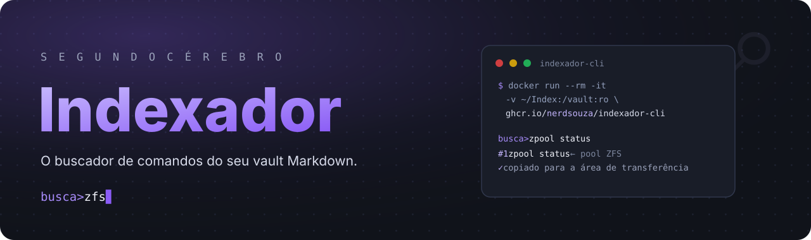
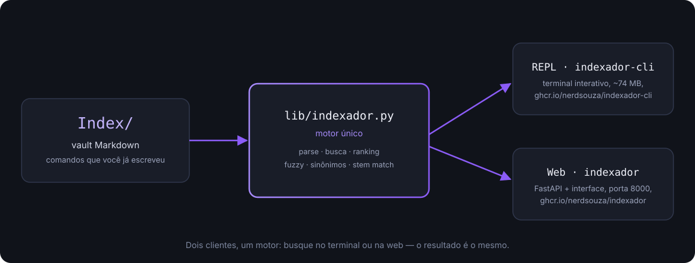

<p align="center">
  
</p>

<p align="center">
  <a href="https://github.com/nerdsouza/indexador/actions/workflows/ci.yml"></a>
  <a href="https://github.com/nerdsouza/indexador/releases"></a>
  <a href="LICENSE"></a>
  <a href="https://github.com/nerdsouza/indexador"></a>
  
  
</p>

---

**Ache qualquer comando do seu acervo em milissegundos** — direto do terminal ou de uma interface web. Sem LLM, sem rede, sem dependência externa na busca: só Python da biblioteca padrão.

O Indexador lê uma pasta de arquivos `.md` (o seu *Index*) e devolve o comando certo para o que você está tentando fazer — tolerante a erro de digitação e acento, com sinônimos e priorização pelo nome do arquivo.

## ✨ O que ele faz

- 🔎 **Busca por palavra-chave** em comando, comentário, seção, label e nome do arquivo (fuzzy opcional com `/` prefixo para buscar só no texto do comando)
- 🧠 **Aprende do acervo que você já tem**: sem índice externo, sem banco, sem embedding
- 🖥️ **REPL no terminal** com autocomplete real (Tab) e cópia do comando escolhido
- 🌐 **Interface web** (FastAPI) para LAN/celular, com explicador de flags (`/api/explicar`) alimentado por um glossário seu
- 🐳 **Duas imagens Docker**: web e CLI leve — mesmo motor compartilhado (`lib/indexador.py`)

## 🚀 Começando em 30 segundos

```bash
# REPL no terminal, sem instalar nada (recomendado)
docker run --rm -it -v ~/cerebro-vault/Index:/vault:ro ghcr.io/nerdsouza/indexador-cli

# ou clone e rode com python
git clone https://github.com/nerdsouza/indexador.git
cd indexador && python3 busca_index.py
```

Aponte para o **seu** acervo com `INDEX_PATH` (default: `~/cerebro-vault/Index`). Sem um vault, comece pelo exemplo: [`examples/modelo.md`](examples/modelo.md).

## 🖥️ Uso

Prompt interativo `busca>`:

| Entrada | O que faz |
|---|---|
| `armazenamento` | busca em comando/comentário/seção/label/arquivo. Default prioriza o arquivo cujo nome bate (*stem match*); senão busca por relevância. Prefixo `/` (`/du -sh`) busca só no texto do comando |
| `2` | escolhe o resultado `#2` — copia para a área de transferência (ou imprime, sem clipboard) |
| `Tab` | autocompleta a linha contra todos os comandos indexados |

O glossário (`Index/glossario-flags.md`) alimenta o explicador `/api/explicar` e **não** polui o índice de comandos. Pastas e arquivos ocultos (`.obsidian/`, `.stfolder/`…) são ignorados automaticamente.

## 🐳 Imagens Docker

| Imagem | Uso | Tamanho |
|---|---|---|
| [`ghcr.io/nerdsouza/indexador`](https://github.com/nerdsouza/indexador/pkgs/container/indexador) | Web (FastAPI, porta 8000) | 114 MB |
| [`ghcr.io/nerdsouza/indexador-cli`](https://github.com/nerdsouza/indexador/pkgs/container/indexador-cli) | CLI leve (REPL) | 74 MB |

Tags `<versão>` e `latest`.

### Compose de cliente (sem build, dia a dia)

```bash
curl -sO https://raw.githubusercontent.com/nerdsouza/indexador/main/docker-compose.client.yml
docker compose -f docker-compose.client.yml up -d          # web em 127.0.0.1:8000
docker compose -f docker-compose.client.yml run --rm cli   # REPL sob demanda
```

Variáveis: `APP_VERSION` (`3.2.0`), `PORT` (`8000`), `INDEX_PATH` (`$HOME/cerebro-vault/Index`). O vault entra **read-only** em `/vault`.

## 🏗️ Arquitetura

<p align="center">
  
</p>

- `lib/indexador.py` — motor de indexação e busca (compartilhado)
- `lib/explicador.py` — decompõe um comando e explica cada flag (texto vem só do glossário; flag sem fonte aparece como "não documentado" — nunca inventado)
- `busca_index.py` — REPL do terminal · `main.py` + `static/` — API e UI web
- `tests/` — o contrato do motor; se quebrar aqui, quebra nos dois clientes

## 🛠️ Desenvolvimento

```bash
git clone https://github.com/nerdsouza/indexador.git && cd indexador
python3 -m venv .venv && source .venv/bin/activate
pip install -r requirements-dev.txt
python -m pytest                 # 45 testes
docker compose build && docker compose up -d   # web dev em 127.0.0.1:8000
```

Formato esperado do Index (ver [`examples/modelo.md`](examples/modelo.md)):

````markdown
## Seção            ← vira a "seção" exibida nos resultados
```bash
comando aqui       # comentário (2+ espaços antes do #)
# label opcional
comando sem comentario
```
````

Regras: fora de bloco ` ```bash ` só `## ` é lido · dentro do bloco, linha com só `#` vira **label** (vale até o fim do bloco) · comentário exige **2+ espaços** antes do `#`.

## 🗺️ Roadmap

- [x] `3.0` busca por relevância com fuzzy e sinônimos
- [x] `3.1` motor compartilhado entre CLI e web; stem match
- [x] `3.2` arquitetura dual Docker (web + CLI) e compose de cliente
- [ ] `3.3` estabilização da API e da interface web
- [ ] `3.4` área "Montar" — decomposição avançada e encadeamento de comandos

> Detalhes em [`PLANO-EVOLUCAO.md`](PLANO-EVOLUCAO.md).

## ⚖️ Licença

MIT — veja [`LICENSE`](LICENSE). Faça o que quiser, só mantenha o aviso de copyright.

<p align="center">Feito por <a href="https://github.com/nerdsouza">NerdSouza</a> · Indexador nasceu como parte do ecossistema <a href="https://github.com/nerdsouza">Lavinia</a></p>
